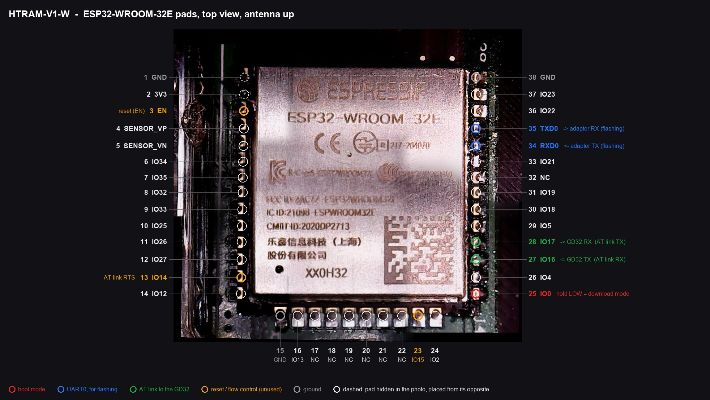

# Hardware

Notes from taking apart a Honeywell HTRAM-V1-W. The PCB is silkscreened
**"Storm Shadow Main Board REV3 20210610"**; "Storm Shadow" is just the
project's internal codename. Board fab: FASTPCB, 2021.

## Main parts

| Ref | Part | Role |
| --- | --- | --- |
| U8 | GigaDevice **GD32F150C8T6** (Cortex-M3, 72 MHz, 64 KB flash, 8 KB RAM, LQFP48) | Main controller: sensor, display, LEDs, buzzer, buttons, battery |
| — | Winbond **W25Q32JV** (4 MB SPI flash, SOIC-8, date code 2106) | Next to the GD32; display graphics and fonts, and the history log (the protocol reads it at 0x200000–0x300000) |
| — | Espressif **ESP32-WROOM-32E** (ESP32-D0WD-V3 rev 3.0, 4 MB flash) | Radio only. Ships with stock **ESP-AT v2.1.0.0-rc2** |
| J6 | 4-pin header | CO2 sensor: Honeywell **CRIR-M1** NDIR (C06-0801-000) |
| J3 | FPC connector | Display |
| LED1–7 | | Status and traffic-light LEDs |
| LS1 | | Buzzer |
| SW1 | | Power / mode button |
| — | micro-USB, 2-pin battery lead, two buck converters | Power |

The GD32 is the brain. It drives the ESP32 purely as an AT-command modem over
a serial link and **switches the ESP32's power itself** — hold the device
button for two seconds and the GD32 powers the module up.

The screen redraws line by line over two to three seconds. With 8 KB of RAM
the GD32 cannot hold a frame (even a 240×240 16-bit frame would be about
115 KB), so it most likely streams graphics from the Winbond flash to the
panel piece by piece, far below what its SPI hardware could do.

## ESP32-WROOM-32E pins that matter

With the antenna pointing up, pins are numbered down the left side (1–14),
along the bottom (15–24) and up the right side (25–38).



*Stitched from four microscope photos of a real unit. Solder left over from
flashing marks pins 25, 34 and 35, and from sniffing the AT link, 27 and 28.
Pins 1 and 2 are hidden in the corner and placed from their opposites.*

| Module pin | Signal | Use |
| --- | --- | --- |
| 1, 15, 38 | GND | |
| 3 | EN | Reset (left side, 3rd from top — hard to reach on this board) |
| 25 | IO0 | Boot mode strap; low at reset = download mode |
| 27 | GPIO16 | **GD32 → ESP32** AT link (already routed on the PCB) |
| 28 | GPIO17 | **ESP32 → GD32** AT link (already routed on the PCB) |
| 34 | RXD0 | UART0 in — flashing and logs |
| 35 | TXD0 | UART0 out — boot ROM log, HomeSpan log |

Right-hand pins sit close to the CO2 sensor housing; go easy with the iron.

On this board **IO0 is held high by something stiffer than a pull-up**
(probably the GD32 itself, which would let it put the ESP32 into download mode
for its own updates). A wire to GND overrides it; a microcontroller pin at
default drive strength does not — see [FLASHING.md](FLASHING.md).

## ESP32 security state

Read with `espefuse summary` — everything is open:

| eFuse | Value |
| --- | --- |
| `FLASH_CRYPT_CNT` | 0 (no flash encryption) |
| `ABS_DONE_0` / `ABS_DONE_1` | False (no secure boot v1/v2) |
| `UART_DOWNLOAD_DIS` | False (UART download allowed) |
| `JTAG_DISABLE` | False |
| BLOCK1–3 | all zero (no keys) |

So the module can be read, written and restored freely.

## Stock flash layout

```
0x001000  bootloader (ESP-IDF v4.0.1)
0x008000  partition table
0x00f000  phy_init       0x1000
0x010000  otadata        0x2000
0x012000  nvs            0xe000    Wi-Fi/BLE state, AT UART settings
0x020000  at_customize   0xe0000   factory params, BLE GATT table, test certs
0x100000  ota_0          0x180000  ESP-AT application
0x280000  ota_1          0x180000  (empty)
```

Inside `at_customize`:

- **factory_param** (0x30000): 115200 baud, AT UART TX = GPIO17, RX = GPIO16,
  CTS = GPIO15, RTS = GPIO14. NVS overrides flow control to RTS only.
- **BLE GATT table** — see [PROTOCOL.md](PROTOCOL.md#bluetooth-service).
- Espressif's default test certificates only; nothing Honeywell-specific.

Nothing about the cloud service, the protocol or the sensor lives on the ESP32:
all of that is in the GD32.

## Main board facts learned over the protocol

- Firmware **V1.00**.
- **No clock battery:** the clock restarts at 2021-01-01 whenever power is lost.
- A **one-minute history log** in a 1 MB ring buffer of the Winbond flash
  (`0x200000`–`0x2fffff`), written in 16-record batches. See
  [PROTOCOL.md](PROTOCOL.md#history-log-verified).
- Activity thresholds, display-off time, alarm sound and °C/°F are stored on
  the main board and survive power loss.

## Not yet explored

- The GD32's SWD port (likely the 5 edge pads near the pogo contacts) and
  whether its readout protection is enabled.
- The rest of the Winbond flash (display graphics, presumably).
- The CO2 sensor's part number and interface.
- The main board's BLE firmware-upgrade path.
